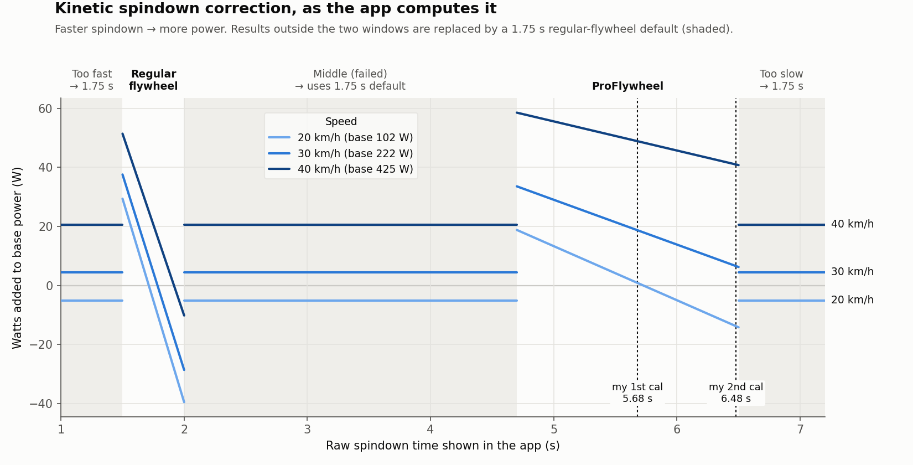

# Kinetic Fit (offline version)

The official Kinetic Fit app was removed from Google Play, and Kinetic's login servers no longer work. This is an **unofficial** copy of the Android app, changed so it opens **without logging in**.

I made it so I could run **spindown calibration** on my Kinetic T-6400 and see the spindown time in seconds, which other apps (MyWhoosh, Zwift, etc.) don't show.

> Not affiliated with Kinetic. Shared as-is for personal use, with no support or warranty.

## Updates

- **Nov 20, 2026: version 1.0.3.** **Import structured workouts** from `.erg` and `.mrc` files, for example from TrainingPeaks, intervals.icu or converted Garmin workouts. Imported workouts are saved in Favorites, and there's no limit on how many you can ride. Install it over 1.0.2.
- **Nov 20, 2026: version 1.0.2.** **Free Ride now works**, with laps and a results screen (per-lap stats, TSS, IF). Fixed the crashes when opening Free Ride or the Profile screen. Install it over 1.0.1; there's no need to uninstall. Then set your FTP under menu (☰) → Profile.
- **Nov 15, 2025: version 1.0.1.** First release: opens without login, with spindown calibration.

## Install

1. On your Android phone, open the [latest release](https://github.com/jayhsu0627/kinetic-fit/releases/latest) and download **`kinetic-fit-bypass.apk`**.
2. Open the downloaded file. If Android asks, allow installing apps from this source.
3. Open the app. It skips the login screen and goes straight to the main screen.

Needs Android 5.0 or newer with Bluetooth. If the original Kinetic app is still on your phone, uninstall it first.

**Updating:** install the new version over the old one. There's no need to uninstall first, and your data is kept.

## What works and what doesn't

- ✅ **Connecting** Kinetic sensors and heart rate monitors
- ✅ **Spindown calibration**, with the time shown in seconds
- ✅ **Free Ride** (version 1.0.2 and later), with laps and a results screen showing per-lap stats, TSS and IF
- ✅ **Your own structured workouts** (version 1.0.3 and later), imported from `.erg` or `.mrc` files. See "How do I add structured workouts?" below.
- ❌ **Kinetic's workouts, training plans and videos.** These were downloaded from Kinetic's servers, which are shut down, so the list is empty. They can't be restored.
- ❌ **Account login and cloud sync.** The app uses a built-in placeholder account instead.

**Set your FTP:** the app starts with an FTP of 200 W and a max heart rate of 185. For correct TSS, IF and zones, open the **menu (☰) → Profile**, enter your own values, and tap **Save & Exit**.

## Common questions

**My trainer doesn't show up in the app.**
Connecting it in your phone's Bluetooth settings doesn't make it appear in the app. (My T-6400 shows up there as "Kinetic 3D:FD".) Instead, search for it from the app's own sensor screen.

**Why does it ask for location permission?**
Android requires location permission for this app to scan for Bluetooth sensors.

**Where did my workouts go?**
See the list above. Everything except Free Ride came from Kinetic's servers. You can add your own workouts instead (next question).

**How do I add structured workouts?**
1. Get the workout as an `.erg` file (target watts) or an `.mrc` file (target % of FTP):
   - **TrainingPeaks** and **intervals.icu** can export or download workouts in these formats.
   - **Garmin Connect** workouts: export the workout as a `.fit` file, then convert it with the free converter at [whatsonzwift.com/convert/workouts](https://whatsonzwift.com/convert/workouts).
   - **MyWhoosh** can't export its workouts.
2. Put the file on your phone, for example by downloading it or emailing it to yourself.
3. Tap the file in your phone's **Files** app and choose **Import Custom Workout** (Kinetic Fit). The workout opens; tap **Warmup** to ride it.
4. Later, find it under **Workout → Favorites**.

Kinetic Fit may also appear in the "Open with" list for ordinary text files. Just pick another app for those.

**How do I use Free Ride?**
Tap **Workout** on the main screen, then **Free Ride**, then **Warmup**. Skip the 10-minute warm-up if you like. During the ride, tap **Lap** to start a new segment. When you're done, tap **Pause → End → Results**.

**Are my rides saved?**
Yes. Finished rides appear on the main screen; scroll down to see them. Tap one to see its results again, including each lap. Rides are stored only on your phone: updating the app keeps them, but uninstalling deletes them.

**Can I upload rides to Strava?**
Not directly. Kinetic's Strava connection has reached Strava's limit on connected athletes, so **Export To Strava** can't be linked, and only Kinetic could fix that. Instead, open the ride, tap **⋮ → Export To File**, and send the `.fit` file to yourself (email or Drive). Then upload it at strava.com (**Upload activity → File**). TrainingPeaks and intervals.icu accept the same file. The other online export options in the menu are untested and probably don't work.

## Understanding spindown calibration

During a spindown you speed up, then stop pedaling and let the trainer coast to a stop. The time it takes tells the app how much drag your tire and roller create, and the app adjusts its power estimate to match. As Jason from Kinetic put it:

> "Spindown calibration is to determine the rolling resistance created by the tire and roller, not about the circumference of the wheel. It adjusts the power curve based on that result."

### 1. Check that the app accepted your result

The app only uses your spindown time if it falls in one of two ranges:

| Your spindown time | What the app does |
|---|---|
| under 1.5 s | ❌ Too fast: ignored, uses a default instead |
| 1.5 – 2.0 s | ✅ Accepted (regular flywheel) |
| 2.0 – 4.7 s | ❌ Ignored, uses a default instead |
| 4.7 – 6.5 s | ✅ Accepted (Pro flywheel) |
| over 6.5 s | ❌ Too slow: ignored, uses a default instead |

⚠️ **The app shows your time even when it ignores it.** If your time is in an ❌ range, adjust the roller or tire pressure and redo the spindown.

### 2. Shorter spindown = more watts

Inside an accepted range:

- **Shorter spindown** (more drag) → the trainer shows **more** watts
- **Longer spindown** (less drag) → the trainer shows **fewer** watts

So if you compare against a power meter:

- **Trainer reads lower than your power meter** → tighten the roller knob a little
- **Trainer reads higher** → loosen it a little, but not so much that the tire slips

**Stay inside the range.** With a Pro flywheel, don't go below 4.7 s. Just below it, the app ignores your result and the reading drops by 20–40 W.



*Each line is a riding speed. Lines slope down as the spindown gets longer, meaning fewer watts. In the shaded areas the app ignores your result and uses a default.*

### 3. Tips for consistent results

- Use the **same tire pressure** every time.
- **Warm up for about 10 minutes** before calibrating. Spindown time changes as the trainer warms up.
- Do **2–3 spindowns** in a row. They vary a little, and each 0.3 s changes the reading by about 5 W.
- Compare with a power meter during **steady efforts** of a few minutes, not short bursts.

## My calibration (Kinetic T-6400)

| | 1st calibration | 2nd calibration |
|---|---|---|
| Tire pressure | 100 PSI | 100 PSI |
| Roller knob | touching the tire + 3 turns | touching the tire + 3⅕ turns |
| Spindown time | 5.68 s ✅ | 6.48 s ✅ |
| My power meter | 60 W / 180 W | |
| Trainer at the same speeds | 45 W / 160 W (measured) | about 29 W / 146 W (calculated) |

**What happened:**

1. After the first calibration, the trainer read **15–20 W lower** than my bike's power meter.
2. I mixed up the direction and loosened the knob 1/5 turn. The tire started slipping under hard efforts, so I tightened it 2/5 turn (net: 1/5 turn tighter than at the start).
3. The new spindown was **longer** (6.48 s), which makes the trainer show about **8–16 W less**. That moved it further from my power meter: the wrong direction.
4. Oddly, the knob ended up tighter but the spindown got longer. That's probably because the trainer was warmer the second time, or just normal variation.

**What I'd try next:** warm up, tighten the knob slightly, and aim for a spindown of about **5.0 s**. That's the shortest time that still leaves a safe margin above 4.7 s. Then compare with the power meter again.

**What I do now:** in MyWhoosh I use my **power meter as the power source** and the trainer only to control resistance. That gives accurate watts no matter how well the trainer is calibrated.

For more on spindown calibration, see this article on [Wahoo KICKR Snap spindown calibration](https://kidsandcowbells.wordpress.com/2016/12/12/wahoo-kickr-snap-spin-down-calibration/). The same ideas apply to Kinetic trainers.

---

## For developers

This repository is the Kinetic Fit 1.4.23 APK (`com.kinetic.fit`, versionCode 220, min SDK 21) unpacked with apktool 2.7.0.

### What was changed

- `smali_classes2/com/kinetic/fit/ui/login/LoginDispathActivity.smali`: `runDispatch()` skips the login and sync screens and opens `RootActivity` directly (via a new `getRootIntent()`).
- `smali_classes2/com/kinetic/fit/data/realm_objects/Profile.smali`: `current()` creates a placeholder "admin" profile if none exists. `getCurrentName()` and `getMainEmail()` return placeholder values.
- `Profile.ensureOfflineDefaults()` (new, called from `runDispatch()` on every launch) fills empty profile fields with defaults: FTP 200, max/resting heart rate 185/60, 70 kg, 175 cm, birth date 1990-01-01, plus auto-calculated power and heart zones. Without zones, Free Ride crashes (`WorkoutGraphView` reads the last power zone). Without a birth date, the Profile screen crashes.
- Workout import (1.0.3), in `ImportWorkoutActivity`:
  - The importer saves locally with a `local-<uuid>` ID instead of waiting for Kinetic's server to assign one, adds the workout to Favorites, and shows a message instead of crashing on unreadable files.
  - `WorkoutParser.parse()` detects `.erg`/`.mrc` from the file's `_display_name` rather than the URI, whose last segment is an ID like `msf:123` on Android 10 and later.
  - `OverviewActivity.onWarmUpButton()` skips the subscription and free-custom-workout gate.
  - The manifest also accepts `application/octet-stream` and `text/plain` content URIs, and `SEND` shares.
- Drawable files whose names contained `$` (`$avd_hide_password__0.xml` etc.) were renamed, with references updated in `res/values/public.xml` and `res/drawable/avd_{hide,show}_password.xml`, so the APK rebuilds.

### Build and install

Requires apktool and the Android SDK build tools (`aapt2`, `zipalign`, `jarsigner`). The `--use-aapt2` flag is required.

Note: this repo is missing about 29 non-code files from the original APK because `.gitignore` excludes them (for example `google.jks` and joda-time's `*.properties`). A plain rebuild drops them. Release APKs are built with `apktool b`; then the missing files are copied in from the previous release APK, followed by `zipalign` and `apksigner` with the same key, so updates install over older versions.

```bash
apktool b . -o kinetic-fit-bypass.apk --use-aapt2

# create a debug keystore if you don't have one
keytool -genkey -v -keystore ~/.android/debug.keystore -alias androiddebugkey -keyalg RSA \
  -keysize 2048 -validity 10000 -storepass android -keypass android -dname "CN=Android Debug,O=Android,C=US"

# sign first, then align (jarsigner breaks alignment)
jarsigner -sigalg SHA256withRSA -digestalg SHA-256 \
  -keystore ~/.android/debug.keystore -storepass android -keypass android \
  kinetic-fit-bypass.apk androiddebugkey
zipalign -v 4 kinetic-fit-bypass.apk kinetic-fit-bypass-aligned.apk

adb uninstall com.kinetic.fit   # only if a differently signed copy is installed
adb install kinetic-fit-bypass-aligned.apk
```

### Power formula

This is in `smali_classes2/com/kinetic/sdk/inride/b.smali` and is used for trainers that report through Kinetic's inRide sensor. Smart Control and FTMS trainers report power from the trainer itself.

1. Base power: `P_base = 5.24482 × v_mph + 0.019168 × v_mph³`
2. Spindown used: the raw result if it is in 1.5–2.0 s (regular) or 4.7–6.5 s (Pro). Otherwise the default of 1.75 s (regular). The UI shows the raw result plus a status flag (Success / TooFast / Middle / TooSlow).
3. Correction, with `t` = spindown used in ms:
   - Regular: `4.55 × t × P_base × 10⁻⁵ − 0.1425 × t + 236.2`
   - Pro: `2.62 × t × P_base × 10⁻⁵ − 0.021 × t + 104.97`
4. `P_final = max(0, P_base + correction)`

`power_curve_visualizer.py` reproduces this logic and draws the chart above.

The older notes (`CALIBRATION_ANALYSIS.md`, `CALIBRATION_FAQ.md`, `SPINDOWN_TROUBLESHOOTING.md`, `SPINDOWN_TIME_SUMMARY.md`, `POWER_DISCREPANCY_ANALYSIS.md`) describe the regular-flywheel range as 1.5–6.5 s. The code only accepts 1.5–2.0 s, as described above.

## Legal notice

This repository contains decompiled code from a proprietary application, shared for educational and personal use only. All rights to the original app belong to its developers. It is not affiliated with or endorsed by Kinetic. Do not use it commercially, and only reverse engineer apps you own or have permission to analyze.
